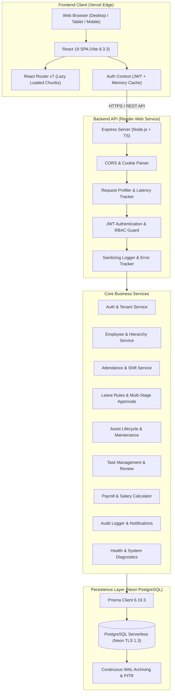
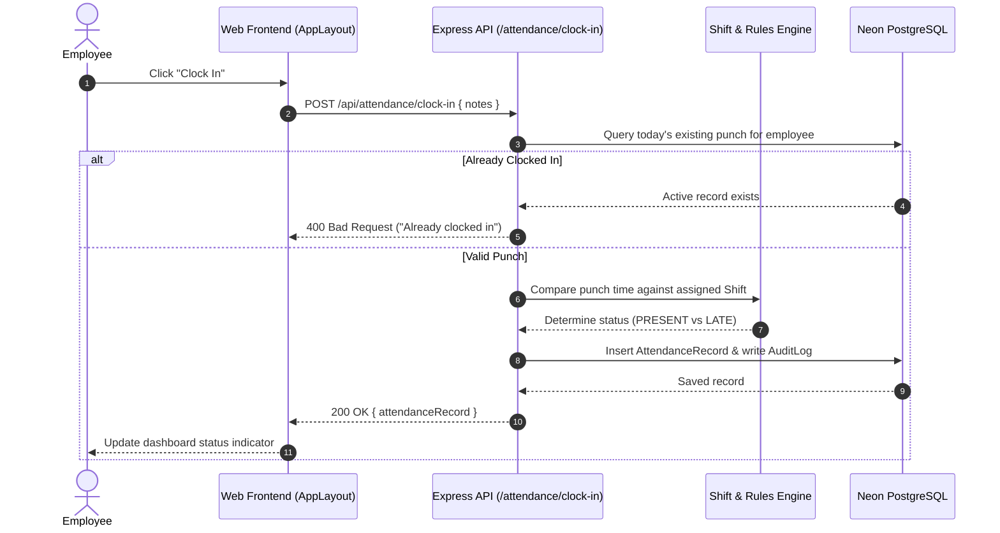
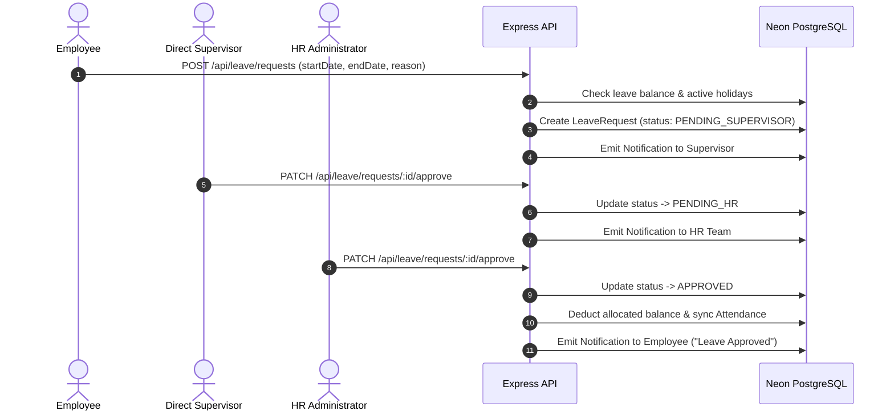

# Oppidan ERMS — System Architecture & Design Specification

## 1. Executive Architecture Overview

The **Oppidan Employee & Resource Management System (ERMS)** is an enterprise HRMS designed for multi-tenant workforce management, shift scheduling, leave approval hierarchies, hardware asset lifecycle tracking, task management, and payroll processing.

The platform follows a decoupled, cloud-native architecture:
- **Frontend SPA**: React 19 + TypeScript + Vite 8.3.3 + Tailwind CSS v4 deployed on Vercel Edge.
- **Backend API**: Node.js + Express + TypeScript deployed on Render Web Services.
- **Relational Database**: PostgreSQL hosted on Neon Serverless (TLS 1.3 encrypted, automated WAL archives and Point-In-Time-Recovery).
- **ORM**: Prisma 6.19.3 with strictly typed schema definitions and migration tracking.

---

## 2. Security & Multi-Tenancy Architecture

### 2.1 Workspace Isolation
Every primary domain model in the database (`Employee`, `Department`, `Designation`, `AttendanceRecord`, `LeaveRequest`, `Asset`, `Task`, `PayrollRecord`, `AuditLog`, `Notification`) is partitioned by `companyId`.
- Queries are automatically scoped to the authenticated tenant's `companyId`.
- Cross-company data leaks are prevented at the service and query layer.

### 2.2 Authentication & Token Rotation
1. **Access Tokens**: Short-lived JSON Web Tokens (JWT) containing `userId`, `companyId`, and `role`.
2. **Refresh Tokens**: Cryptographically secure, rotating refresh tokens stored as `HttpOnly`, `SameSite=Lax/None`, `Secure` cookies.
3. **Password Security**: Passwords salted and hashed with `bcryptjs` (work factor 10).
4. **Data Sanitization**: Passwords, refresh tokens, and payment secrets are automatically redacted in the structured logging pipeline.

### 2.3 Role-Based Access Control (RBAC) Matrix

| Module | OWNER | HR | MANAGER | SUPERVISOR | EMPLOYEE |
|---|:---:|:---:|:---:|:---:|:---:|
| **Workspace Settings** | Full Access | View / Edit | Denied | Denied | Denied |
| **User Management** | Full Access | View / Edit | Denied | Denied | Denied |
| **System Diagnostics** | Full Access | Full Access | Denied | Denied | Denied |
| **Employee Directory** | Full Access | Full Access | View / Team | View / Team | View Self |
| **Attendance Punch** | Yes | Yes | Yes | Yes | Yes |
| **Attendance Corrections**| Full Access | Approve / Reject | Review Team | Review Team | Submit Self |
| **Leave Management** | Override | Final Sign-Off | Approve Team | Endorse Team | Apply / View Self |
| **Hardware Assets** | Full Access | Allocate / Manage | View Allocated | View Allocated | View My Assets |
| **Tasks & Reviews** | Full Access | Full Access | Assign / Review | Review / Assign | Update Assigned |
| **Payroll Processing** | Full Access | Full Access | Denied | Denied | View Payslips |
| **Audit Logs** | Full Access | View | Denied | Denied | Denied |

---

## 3. Data Flow Architecture

### 3.1 Attendance Clock-In & Verification

### 3.2 Multi-Stage Leave Approval

---

## 4. Performance, Resiliency & Monitoring

### 4.1 Frontend Code Splitting
- All 28+ application pages are split using `React.lazy()` and dynamic imports.
- Reusable libraries (`react`, `react-dom`, `react-router-dom`) are bundled into an independent `vendor-react` chunk.
- Icons are bundled into an isolated `vendor-icons` chunk.
- Initial bundle payload is reduced to **59.77 kB** (from >1,050 kB).

### 4.2 Backend Diagnostics & Telemetry
- **Latency Profiler**: Tracks median and peak response times per route.
- **Ring-Buffer Error Tracker**: In-memory ring buffer capturing the 50 most recent operational exceptions.
- **Neon Health Probes**: Real-time roundtrip query latency monitoring exposed on `/settings/health`.
- **Global Error Boundary**: Client-side React error boundary preventing white-screen cascades on unexpected runtime errors.
