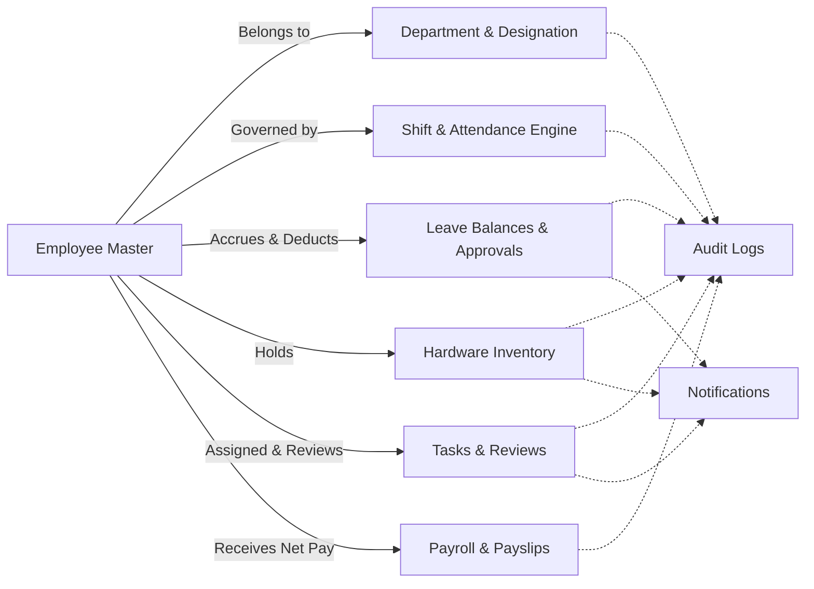

# Oppidan ERMS — Cross-Module Integration Specification

## 1. Integration Matrix Overview

Oppidan ERMS integrates workforce records across 8 distinct business modules. Data consistency is enforced through foreign key constraints, Prisma transactions, and event-driven logging.

---

## 2. Detailed Module Interactions

### 2.1 Employee + Department & Designation
- When an employee's department changes, the change cascades immediately to directory views, departmental filter dropdowns, and task grouping reports.
- An immutable `EmploymentHistory` entry (`DEPARTMENT_CHANGE`) is logged with the timestamp and acting administrator's user ID.

### 2.2 Employee + Attendance & Shifts
- Attendance punches dynamically evaluate the employee's active `ShiftAssignment`.
- Punch times exceeding the shift start time plus grace period automatically flag the record as `LATE`.
- Shift definitions govern weekly rest days, preventing false absent records on scheduled weekends.

### 2.3 Employee + Leave Management
- Approved leaves automatically sync with the attendance calendar, populating the employee's status as `ON_LEAVE`.
- Double-booking prevention ensures an employee cannot request overlapping leave windows or clock in while marked on approved full-day leave.

### 2.4 Employee + Hardware Assets
- Asset assignments record the employee ID, allocation date, and device condition.
- When an employee is deactivated, an alert prompts HR to initiate an asset return workflow.
- Hardware remains locked to the employee until an explicit return or reassignment is processed.

### 2.5 Employee + Task Management
- Tasks can be assigned to subordinates within the manager's or supervisor's departmental scope.
- Completed tasks progress to `UNDER_REVIEW`, alerting the assigned reviewer.
- When an employee leaves a department, existing open tasks can be bulk-reassigned to a peer.

### 2.6 Employee + Payroll & Salary Structures
- Each employee is linked to a active `SalaryStructure` record.
- Monthly batch payroll processes attendance summaries for the corresponding billing month:
  $$\text{Payable Days} = \text{Total Working Days} - \text{Unpaid Absences}$$
- Generated payslips display gross earnings, attendance deductions, EPF/ESI statutory withholdings, and final net remuneration.

### 2.7 Cross-Cutting: Notifications & Audit Logging
- **Event-Driven Notifications**: Generated for leave approval state transitions, task assignments, and asset returns.
- **Append-Only Audit Trail**: Administrative mutations (salary adjustments, user role promotions, employee deactivations) automatically log IP address, user agent, actor ID, and metadata diffs to PostgreSQL.
