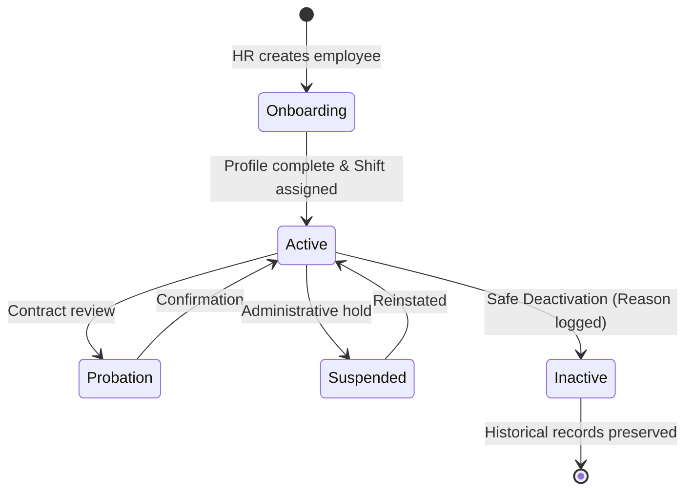

# Oppidan ERMS — Employee Lifecycle Workflow Specification

## 1. Lifecycle Overview & Architecture

The **Employee Lifecycle** represents the core operational journey within Oppidan ERMS. From onboarding to deactivation, every state mutation is governed by transactional consistency, multi-tenancy constraints, and append-only employment history tracking.

---

## 2. The 10-Step Operational Lifecycle

### Step 1: Employee Provisioning (HR / Owner)
- HR navigates to `/employees/new` (`POST /api/employees`).
- Generates a unique, tenant-scoped employee code (e.g. `EMP-0024`).
- Captures employee legal name, email, department, designation, and optional joining date.
- Initial status: `ACTIVE`.

### Step 2: User Account Association & Authentication
- User account is linked to the employee record via `User.employeeId`.
- Role assignment determines permission boundaries (`EMPLOYEE`, `SUPERVISOR`, `MANAGER`, or `HR`).

### Step 3: Organizational Hierarchy & Supervisor Mapping
- Employee is assigned a Direct Supervisor via `supervisorId`.
- **Validation Rule**: Circular reporting hierarchies (A reports to B, B reports to A) and self-supervision (A reports to A) are rejected with `400 Bad Request`.

### Step 4: Shift & Working Schedule Assignment
- Employee is mapped to an organizational shift template (`POST /api/shift-assignments`).
- Defines start time (e.g. `09:00`), end time (`18:00`), working days (`Monday - Friday`), and grace minutes.

### Step 5: Real-Time Attendance & Punctuality
- Employee records daily arrival and departure punches via `/attendance/my`.
- Shifts automatically classify punch times as `PRESENT` or `LATE`.
- Missed punch correction requests progress through supervisor validation.

### Step 6: Leave Entitlement Ledger
- Initial leave balances (Annual, Sick, Casual, Unpaid) are allocated upon onboarding.
- Applications compute working days excluding weekends and company holidays.
- Two-stage approval hierarchy (Direct Supervisor -> HR) deducts balance upon final sign-off.

### Step 7: Asset Allocation & Tooling
- Hardware assets (laptops, monitors, peripherals) are allocated via `POST /api/assets/:id/allocate`.
- Asset condition and serial numbers are tied to the employee's profile.

### Step 8: Task Delegation & Review
- Supervisors assign prioritized tasks with due dates (`POST /api/tasks`).
- Employee updates progress and submits tasks for supervisor review.

### Step 9: Attendance-Integrated Payroll
- Salary structures define monthly base pay, allowances, and statutory deductions.
- Monthly payroll batch calculations cross-reference actual attendance, approved paid leaves, and unpaid absences.

### Step 10: Safe Deactivation & Historical Protection
- Deactivation is triggered via `PATCH /api/employees/:id/deactivate`.
- **Critical Policy**: Employees are **never hard-deleted** from PostgreSQL.
- Status transitions to `INACTIVE`.
- An immutable `EmploymentHistory` entry is written with change type `STATUS_CHANGE` and mandatory justification notes.
- Historical attendance records, payslips, leave requests, and asset returns remain permanently preserved.
