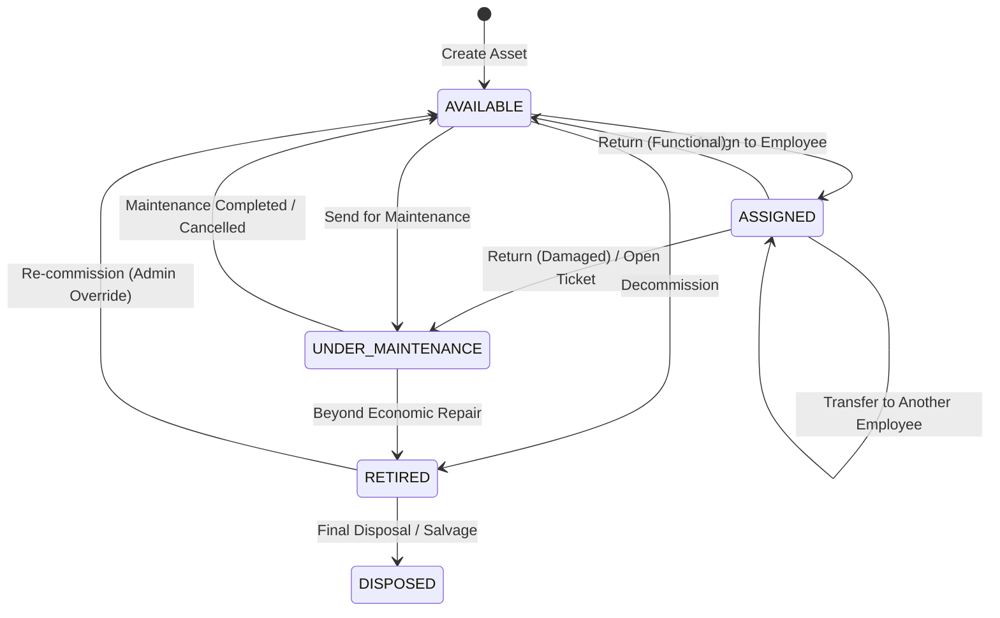

# Asset Lifecycle and Status Transition Rules

This document outlines the asset lifecycle, data models, permitted state transitions, allocation rules, and maintenance workflows implemented for the **Employee and Resource Management System (ERMS)** Week 5 Asset & Inventory module.

---

## 1. Asset Lifecycle Statuses

Every asset in the ERMS belongs to a specific company/tenant and possesses one lifecycle status at any given time:

| Status | Description | Can be Assigned? | Can Create Maintenance? |
| :--- | :--- | :---: | :---: |
| **`AVAILABLE`** | In inventory / storage, functional, ready for allocation to an active employee. | **Yes** | Yes |
| **`ASSIGNED`** | Allocated to and in possession of an active company employee. | No (Already assigned) | Yes |
| **`UNDER_MAINTENANCE`** | In repair, diagnosis, or servicing. Asset is marked unavailable. | **No** (Blocked) | Yes (Ticket active) |
| **`RETIRED`** | Decommissioned, reached end-of-life, or obsolete. Not in operational use. | **No** (Blocked) | No |
| **`DISPOSED`** | Scrapped, recycled, returned to lessor, or sold. Terminal state. | **No** (Blocked) | No |

---

## 2. Permitted Status Transitions

### Transition Validation Rules

1. **`AVAILABLE` → `ASSIGNED`**:
   - Target employee must be an **ACTIVE** employee in the same company.
   - Asset must not have open maintenance tickets that mark it unavailable.
   - An `AssetAssignment` record is created with `status = ACTIVE`, capturing `assignedDate`, `conditionAtAssignment`, and `assignedById`.

2. **`ASSIGNED` → `AVAILABLE` (Return)**:
   - Asset must currently be assigned.
   - Active `AssetAssignment` record is closed (`status = RETURNED`), capturing `returnDate`, `returnNotes`, `conditionAtReturn`, and `returnedById`.
   - Asset `assignedEmployeeId` is cleared (`null`).
   - If returned in damaged condition, authorized user can immediately transition it to `UNDER_MAINTENANCE`.

3. **`ASSIGNED` → `ASSIGNED` (Transfer)**:
   - Source employee must hold the current assignment.
   - Target employee must be active and in the same company.
   - Active `AssetAssignment` is marked `status = TRANSFERRED` with `returnDate = now`.
   - New `AssetAssignment` is created with `status = ACTIVE` for the recipient employee.
   - Asset `assignedEmployeeId` is updated to the new employee.

4. **`AVAILABLE` or `ASSIGNED` → `UNDER_MAINTENANCE`**:
   - Maintenance ticket is created (`status = OPEN` or `IN_PROGRESS`).
   - If asset was assigned and needs replacement or off-site repair, it can either be returned first or maintained in-situ. By default, opening a blocking maintenance ticket sets asset `status = UNDER_MAINTENANCE`.
   - While `UNDER_MAINTENANCE`, the asset cannot be assigned to any employee.

5. **`UNDER_MAINTENANCE` → `AVAILABLE`**:
   - Maintenance ticket status is set to `COMPLETED` or `CANCELLED`.
   - If no other active maintenance tickets exist for the asset, its status is restored to `AVAILABLE` (or previous assigned state if retaining assignment).

6. **`AVAILABLE` / `UNDER_MAINTENANCE` → `RETIRED`**:
   - Asset must have no active assignment (must be returned first).
   - Only `OWNER` or `HR` can retire an asset.

7. **`RETIRED` → `DISPOSED`**:
   - Permanent archival / disposal. Asset details and historical records are preserved for auditing.

---

## 3. Maintenance Ticket Workflow

Maintenance tickets track repairs, servicing, calibration, and vendor interactions.

### Ticket Statuses:
- **`OPEN`**: Issue reported, awaiting diagnostic or technician assignment. Asset status moves to `UNDER_MAINTENANCE`.
- **`IN_PROGRESS`**: Repair or service actively underway.
- **`WAITING_PARTS`**: Servicing paused awaiting replacement components or vendor response.
- **`COMPLETED`**: Repair completed, verified, resolution notes logged, and asset returned to `AVAILABLE`.
- **`CANCELLED`**: Ticket dismissed (e.g. false alarm, duplicate ticket). Asset returned to `AVAILABLE`.

### Ticket Priorities:
- **`LOW`**: Cosmetic or minor issue, non-urgent.
- **`MEDIUM`**: Standard service request or degraded performance.
- **`HIGH`**: Urgent defect preventing full work execution.
- **`CRITICAL`**: Safety hazard or critical infrastructure failure.

---

## 4. Multi-Tenant Data Isolation & Security Rules

1. **Company Isolation**: Every query (`Asset`, `AssetAssignment`, `AssetMaintenance`) is strictly filtered by `companyId`.
2. **Unique Asset Code**: Asset codes (e.g. `AST-2026-0001`) must be unique within each company (`@@unique([companyId, assetCode])`).
3. **Role-Based Access Control**:
   - **`OWNER` & `HR`**: Full access to create, edit, assign, return, transfer, retire, and service all company assets.
   - **`MANAGER`**: View company/departmental asset directories, view allocations, and submit maintenance tickets.
   - **`SUPERVISOR`**: View assets assigned to themselves and their direct subordinates.
   - **`EMPLOYEE`**: View their own assigned assets and personal allocation history (`/assets/my`). Cannot alter inventory or assign assets.
